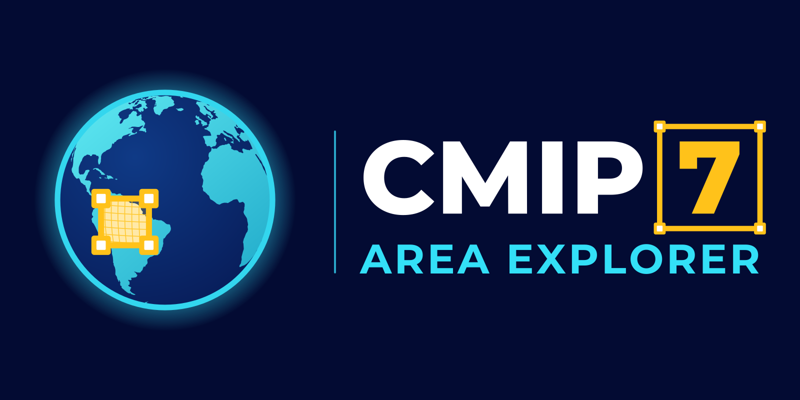

<p align="center">
  
</p>

# CMIP7 Area Explorer & ESGF-NG Web Portal

- **Live Web App**: **https://mgpcamargo.github.io/cmip7-area-explorer/** (English · Português · Español)
- **Visual User Guides (PDF)**:
  - English: **[docs/CMIP7_Area_Explorer_Visual_Guide.pdf](docs/CMIP7_Area_Explorer_Visual_Guide.pdf)**
  - Português (PT-BR): **[docs/CMIP7_Area_Explorer_Visual_Guide_PT-BR.pdf](docs/CMIP7_Area_Explorer_Visual_Guide_PT-BR.pdf)**
  - Español (ES): **[docs/CMIP7_Area_Explorer_Visual_Guide_ES.pdf](docs/CMIP7_Area_Explorer_Visual_Guide_ES.pdf)**

Open-source interactive cartographic web application and zero-dependency Python CLI helper to delimit a geographic bounding box, diagnose eligible **CMIP7** (`MIP-DRS7`) realms and branded variables, query live **ESGF-NG STAC** catalogs, inspect NetCDF assets, and export reproducible regional subsetting scripts.

> *Community-contributed open-source tool for WCRP CMIP7 (MIT License). CMIP7 climate model outputs accessed via ESGF-NG are licensed under **CC-BY-4.0**.*

## Key Capabilities

- **High-Detail Cartographic Base & Satellite Switcher**:
  - **Natural Earth 1:50m Vector Atlas** (`data/world-50m.js`, public domain) with 241 countries/territories and lakes.
  - **Layers Switcher** (beneath zoom controls) projected seamlessly in both **Natural Earth** and **Equirectangular** views:
    - **Atlas** (`1:50m` vector)
    - **Satellite** (ESA Copernicus Sentinel-2 Cloudless via EOX, CC-BY-4.0)
  - Toggleable overlays for **Borders & Labels** and **Lat/Lon Grid**, plus **double-click / double-tap country selection** to fit any country's full bounding box.
- **Area-Aware CMIP7 Eligibility Diagnostics**:
  - Computes spherical global area fraction, detects **Land / Ocean / Polar** surface masks, and lists intersecting territories.
  - Flags compatible CMIP7 realms (`atmos`, `land`, `ocean`, `ocnBgchem`, `seaIce`) and branded variables (`tas_tavg-h2m-hxy-u`, `tas_tmax-h2m-hxy-u`, `pr_tavg-u-hxy-u`, `tos_tavg-u-hxy-sea`, `mrso_tavg-u-hxy-lnd`, etc.).
- **Live ESGF-NG STAC Dataset Explorer & Download Cart**:
  - Queries `https://discovery.east.esgf.io/search` (with automatic fallback to `https://api.stac.esgf.ceda.ac.uk/search`) for live CMIP7 holdings.
  - Filter by model (`source_id`), frequency, grid label (`g110`, `g126`, etc.), inspect individual `.nc` assets, and export `subset_cmip7.py` (`intake-esgf` + `xarray` area crop) or `download_cmip7.sh` (`wget` + `cdo sellonlatbox`).
- **Multilingual UI & Unified Guides Tab**:
  - Instant switching between **English**, **Português (PT-BR)**, and **Español (ES)** (`?lang=en|pt|es`), defaulting to English.
  - Unified **Guides** tab with localized **Visual User Guide PDFs**, CMIP7 data access & syntax reference, a 30-term **Glossary**, collapsible **FAQs**, and persistent Light/Dark themes.

## Local Usage

### Web App

Serve locally with Python (or open `index.html` directly):

```bash
python3 -m http.server 8000
# then open http://localhost:8000
```

### Python Area Checker CLI (Standard Library Only)

```bash
python3 scripts/cmip7_check_area.py \
  --bbox -82 -56 -34 13 \
  --experiment scen7-vl \
  --variable tas \
  --branded tas_tavg-h2m-hxy-u
```

## Citation & License

- **Software License**: [MIT License](LICENSE) — Copyright (c) 2026 Marcelo G. P. Camargo (Department of Atmospheric Sciences, IAG/USP).
- **Citation**: Metadata provided in [`CITATION.cff`](CITATION.cff) (use GitHub's *"Cite this repository"* button).
- **Data & Map Credits**:
  - CMIP7 model datasets: WCRP CMIP7 participating modeling groups (**CC-BY-4.0**).
  - Vector boundaries & lakes: Natural Earth 1:50m (**Public Domain**).
  - Satellite imagery tiles: ESA Copernicus Sentinel-2 Cloudless via EOX IT Services GmbH (**CC-BY-4.0**).

## CMIP7 References

- [WCRP CMIP7 Guidance](https://wcrp-cmip.github.io/cmip7-guidance/)
- [WCRP-CMIP Tools Database](https://wcrp-cmip.org/tools/)
- [ESGF MetaGrid Portal](https://metagrid.esgf-west.org/)
